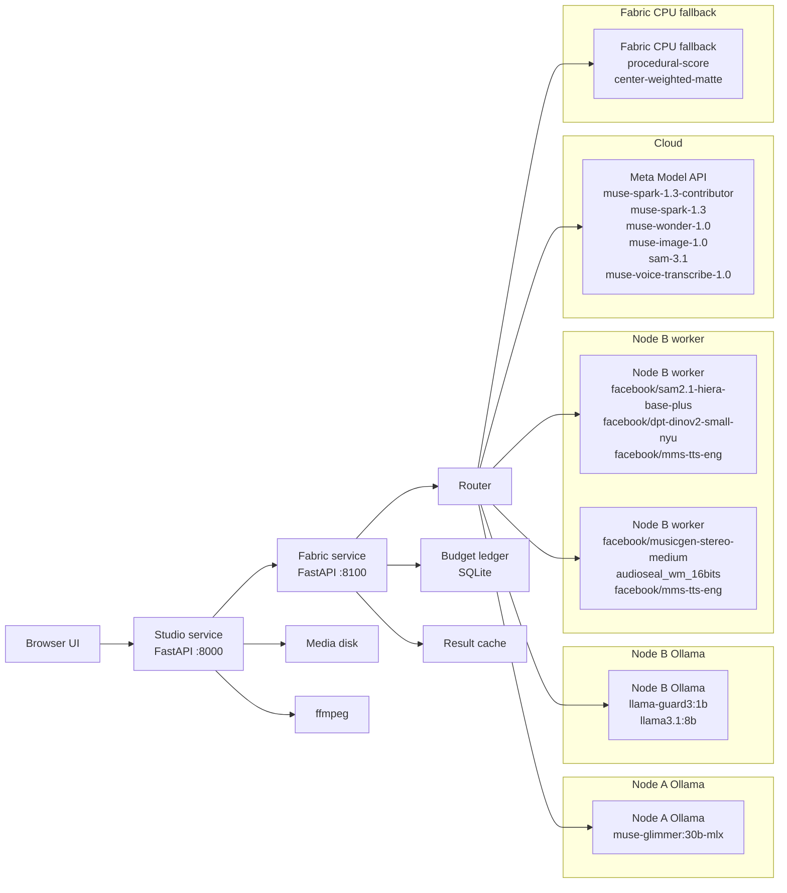
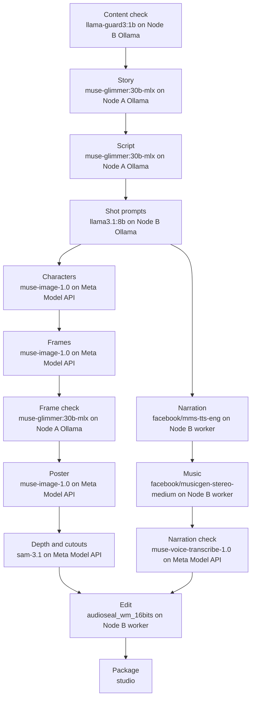

# Architecture

CinemaFabric splits a Browser UI, Studio FastAPI on 8000 and Fabric FastAPI on 8100 with router, SQLite budget ledger and content-hash result cache. The router picks local-first, balanced or cloud-first candidates by kind, tier, health and budget, with reservation, fallback, circuit breaking and draft-quality degradation. Parallel visual and audio tracks render on Node A Ollama, Node B Ollama, Node B workers and Meta Model API before Studio edits with ffmpeg and packages to disk.

## System

## Production pipeline

## Routing rules

- Each task names a kind (text, image, segment, tts, music, transcribe), a quality tier and a compute preference.
- Candidates are workers whose offers match the kind, meet the tier, support vision if needed, are healthy, and (for cloud) fit the remaining budget.
- Local-first sorts by (is_cloud, cost, expected seconds); balanced scores cost*100 + seconds*0.02 + cloud nudge; cloud-first prefers the API.
- Expected seconds = measured latency EMA + queue depth; Ollama and GPU workers run one task at a time.
- Cloud calls reserve estimated cost in the ledger before running and settle actual cost after; an optional spending limit refuses reservations that would pass it.
- On failure the router falls back to the next candidate; two consecutive failures open a 30 s circuit breaker.
- Results are cached by content hash, so retries and replays cost $0.
- If nothing meets the tier the router degrades to draft quality (e.g. procedural score) rather than failing.

---

*These diagrams were generated by `muse-spark-1.3-contributor` on **Meta Model API · Muse**, routed through CinemaFabric's own
fabric (cost $0.0007). Regenerate with `python -m cinemafabric.tools.architecture`.*
